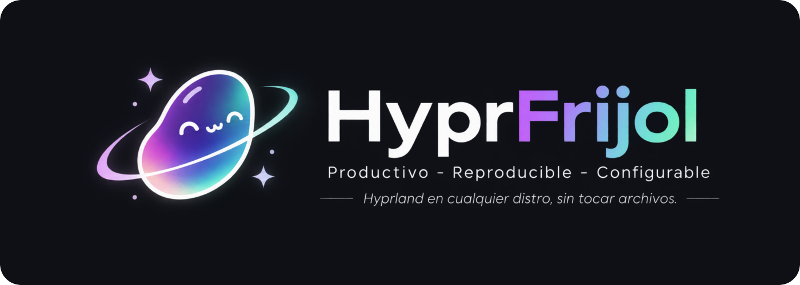

<p align="center">
  <picture>
    <source media="(prefers-color-scheme: dark)" srcset="assets/brand/logo.png">
    
  </picture>
</p>

# HyprFrijol (English summary)

HyprFrijol is a from-scratch shell and rice for **Hyprland ≥ 0.57** (Lua config) built with **Quickshell**: a glassy *Aurora* style and a solid *Material* style, Spotlight, a side panel with AI and web apps, wallpaper picker, widgets, an update center with restore points, screenshots/recording, and its own greetd login. The interface and docs are in Spanish; see [README.md](README.md) for the full guide.

It runs as a **separate session** from the repo folder and never touches `~/.config/hypr`, `~/.config/quickshell` or `~/.config/matugen`.

## Install

Works on any distro, including minimal/server installs **without a desktop environment** (no Xorg, no display manager, no audio stack): the installer adds the packages, enables logind/PipeWire/NetworkManager (without silently replacing another network stack) and sets up the session.

```bash
curl -fsSL https://raw.githubusercontent.com/fsanchezlme97-ui/hyprfrijol/main/install/bootstrap.sh | bash
# or
git clone https://github.com/fsanchezlme97-ui/hyprfrijol ~/hyprfrijol && cd ~/hyprfrijol
./install.sh --dry-run   # print the exact commands, change nothing
./install.sh             # packages + services + ~/.local/bin links + "Hyprland (HyprFrijol)" session
```

Options: `--yes` (non-interactive), `--full` (optional extras too), `--no-deps`, `--no-system`, `--no-session`, `--greeter` / `--greeter-off` (greetd login, restores your previous display manager), `--uninstall [--purge]`, `--migrate`. Simulate another distro with `HF_DISTRO=fedora ./install.sh --dry-run`.

| Distro | Hyprland ≥ 0.57 | Quickshell |
|---|---|---|
| Arch, CachyOS, EndeavourOS, Garuda (Manjaro: testing branch) | official repos | official repos |
| Fedora 44+ | COPR `lionheartp/Hyprland` | same COPR |
| openSUSE Tumbleweed | official repos | OBS `home:AvengeMedia:danklinux` |
| Debian testing (forky) / sid | official repos | official repos |
| Ubuntu 26.04 / 24.04 (Mint, Pop!_OS) | PPA `cppiber/hyprland` | PPA `avengemedia/danklinux` (26.04; build on 24.04) |
| Void | build from source or Nix | official repos |
| Gentoo / NixOS | hyproverlay / `programs.hyprland` | guru / nixpkgs (instructions only) |

RHEL-likes, openSUSE Leap, Debian 13 and Ubuntu 26.10 get everything except Hyprland, with instructions. Third-party repos (COPR, OBS, PPA) are community-maintained, and the installer asks before adding them. Dependency list per distro: [`install/packages.tsv`](install/packages.tsv).

Without a display manager, log in on a TTY and run `hf-session`. To try it inside your current session: `hf-session --nested`.

## Uninstall

```bash
./install.sh --greeter-off        # only if you enabled the greetd login
./install.sh --uninstall          # links, launchers and session entry
./install.sh --uninstall --purge  # also settings, state and cache
```

## License

[MIT](LICENSE).
