<p align="center">
  <picture>
    <source media="(prefers-color-scheme: dark)" srcset="assets/brand/logo.png">
    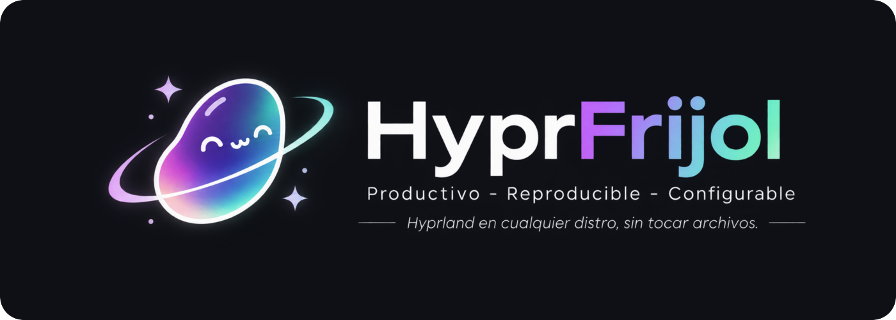
  </picture>
</p>

# HyprFrijol

Rice/shell propio para **Hyprland**, hecho desde cero, con un estilo propio, *Math* (Material 3, sólido o con transparencia y desenfoque), y temas en pares oscuro y claro; tono empresarial y minimalista, y varios agregados: Spotlight, panel lateral con asistente de IA, PiP mínimo, selector de fondos, widgets, centro de actualizaciones con punto de restauración, captura/grabación y login propio.

Pensado para correr en **cualquier distro que tenga Hyprland 0.57 o posterior** (Arch y derivadas, Fedora, openSUSE Tumbleweed, Debian testing, Ubuntu, Void, Gentoo, NixOS), también en una instalación mínima o de servidor **sin escritorio**: el instalador pone lo que falta. No depende de GNOME, KDE ni de GDM.

*English: see [README.en.md](README.en.md).*

## Cómo convive con tu sistema

HyprFrijol **no toca** `~/.config/hypr`, `~/.config/quickshell` ni `~/.config/matugen`. Se ejecuta desde la carpeta del repo como una **sesión aparte**:

| Qué | Dónde |
|---|---|
| Configuración (Hyprland, Quickshell, plantillas) | este repo |
| Lo generado: colores, fondo, estado | `~/.local/state/hyprfrijol/` |
| Tus ajustes personales (nunca se sobrescriben) | `~/.config/hyprfrijol/local.lua` |

Así puedes tener otro rice instalado y elegir uno u otro al iniciar sesión.

## Estado

Las 53 pantallas del prototipo (`design/`, renders en `design/capturas/`) están construidas en Quickshell. Cada vista se probó en una sesión anidada con `dev/try.sh`, sin avisos de QML.

| Parte | Dónde |
|---|---|
| Hyprland en Lua, validado con `Hyprland --verify-config` | `config/hypr/frijol/` |
| Sesión aparte y modo de prueba en ventana (`hf-session --nested`) | `scripts/hf-session` |
| Colores del fondo (matugen) o 12 temas en pares oscuro y claro, estilo Math (Material 3) con o sin transparencia, claro / oscuro / auto, redondeo ajustable | `scripts/hf-apply`, `config/themes/` |
| Barra abajo / arriba / izquierda, fija o flotante | `quickshell/bar/` |
| Spotlight (apps, archivos, calculadora, comandos, ventanas) | `modules/spotlight` |
| Ajustes rápidos, notificaciones con respuesta, OSD | `modules/quicksettings`, `notifications`, `osd` |
| Panel lateral con el asistente de IA (¼ de pantalla), PiP mínimo | `modules/sidepanel`, `pip` — ver `docs/IA.md` |
| Vista general, Alt+Tab, Snap, dock y escritorio ordenado, widgets | `modules/overview`, `alttab`, `snap`, `desktop`, `widgets` |
| Selector de fondos (por monitor, por hora, mono), captura sobre la pantalla congelada (lupa, ventanas, fijar, OCR con cajas, anotación, IA) / grabación, selector de color (HEX · RGB · HSL · OKLCH, historial) | `modules/wallpapers`, `capture`, `colorpicker` |
| Portapapeles y emojis en Spotlight, agenda (con `.ics`), centro de actualizaciones con punto de restauración | `modules/spotlight`, `agenda`, `updates` |
| Memorias USB y tarjetas SD (aviso con Abrir/Expulsar, icono en la barra, Ajustes › Almacenamiento), cola de descargas de vídeo, audio, imágenes y archivos (yt-dlp, gallery-dl, aria2c; «descargar <url>» en Spotlight), fondos de Wallhaven, y una IA que enseña qué cambia y pide tu aprobación paso a paso | `scripts/hf-devices`, `hf-download`, `hf-wallhaven` · `modules/devices`, `downloads` |
| Bloqueo, menú de energía, modo sin distracciones, agente de polkit | `modules/lock`, `power`, `focus`, `polkit` |
| Aplicación de ajustes, bienvenida, herramientas | `modules/settings`, `welcome`, `tools` |
| Apps por nivel (de serie, productividad, destacadas, creativa, experimental) con instalación por distro, apps predeterminadas y menú «HyprFrijol» en Nautilus (IA, firmar PDF, OCR, convertir, poner de fondo) | `install/apps.json`, `scripts/hf-apps`, `hf-fileact`, `config/nautilus/` |
| Login con greetd (Quickshell) | `greeter/` |
| «Que no se rompa»: modo seguro en el login, copias «buenas» de tus ajustes, diagnóstico copiable y actualización por versiones con vuelta atrás | `scripts/hf-safe`, `hf-doctor`, `hf-update`, `config/hypr/safe.lua` |
| Carga diferida: Spotlight, centro de control, vista general, capturas y demás paneles solo ocupan memoria mientras se usan (`lazyModules`, Ajustes › Energía y rendimiento) | `components/LazyView.qml`, `modules/Modules.qml` |
| Plugins de Omarchy (widget de barra, panel, overlay, menú y servicio; se piden permiso al activarlos) y temas `colors.toml` de Omarchy como paletas | `scripts/hf-plugin`, `modules/omarchy`, `quickshell/Commons`, `Ui` |

## Capturas

Capturas reales a 1920×1080 de una sesión de HyprFrijol 0.8.6 con la configuración por defecto (paleta Oxocarbon, estilo Material, barra arriba en archipiélago), ventanas de verdad abiertas y un fondo de [Wallhaven](https://wallhaven.cc/w/3q23od) (no incluido en el repo).

| | |
|---|---|
| 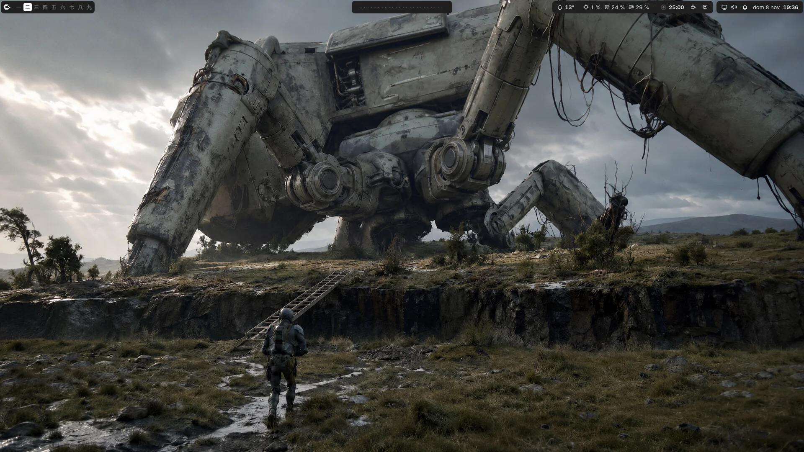 | 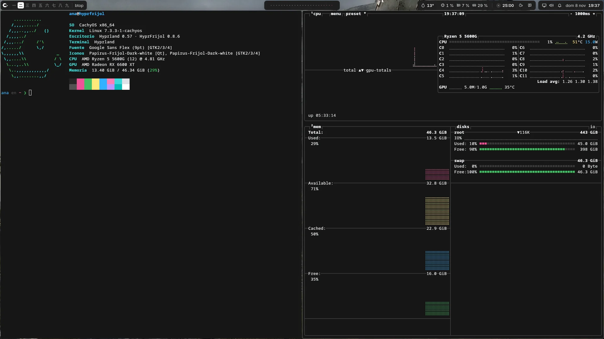 |
| **Escritorio** · barra arriba en islas: espacios, onda de audio, tiempo, recursos y reloj | **Terminal** · kitty, GTK, Qt/KDE y btop siguen la paleta activa |
| 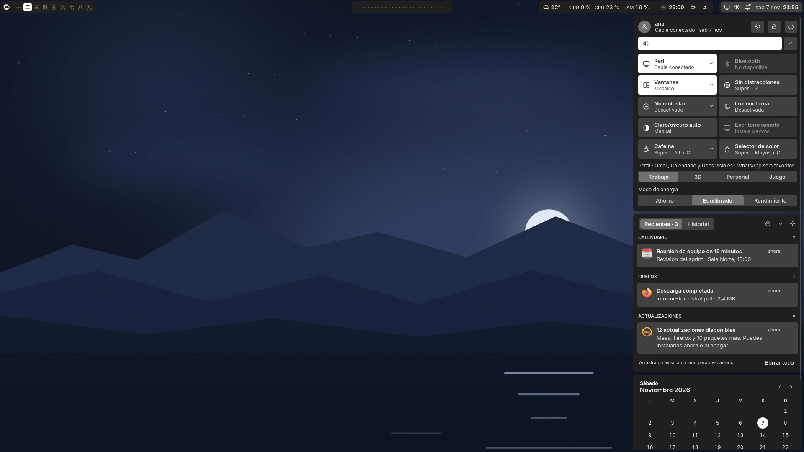 | 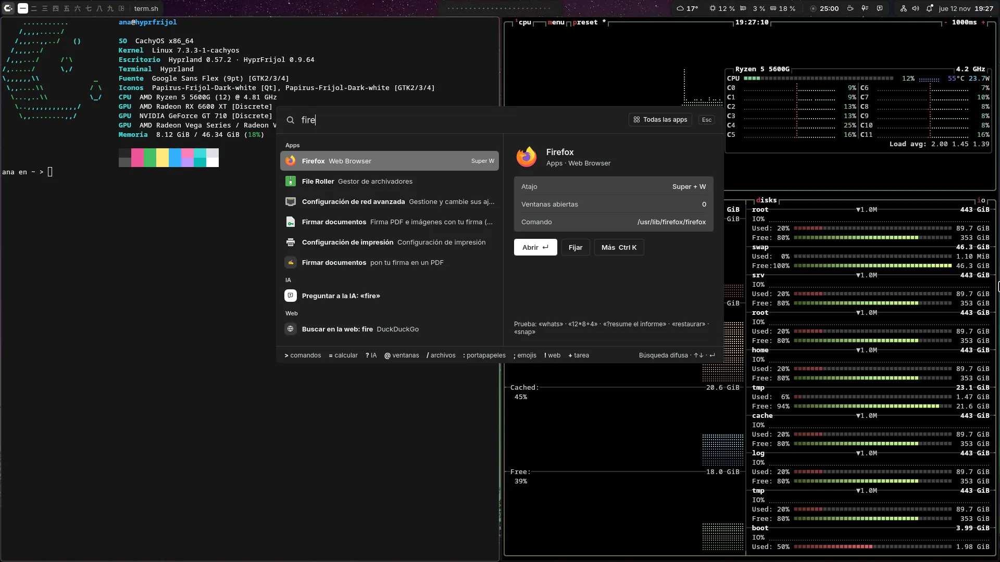 |
| **Centro de control** · ajustes rápidos, avisos, agenda y relojes del mundo en un solo panel | **Spotlight** · apps, ajustes, acciones, archivos, calculadora, IA y web desde un buscador |
| 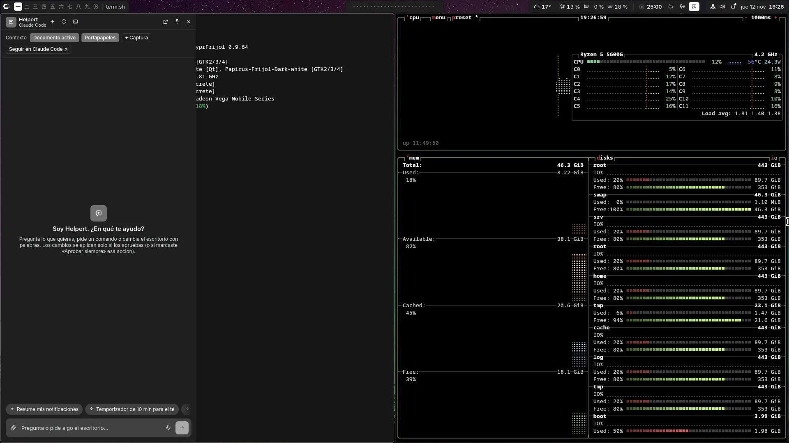 | 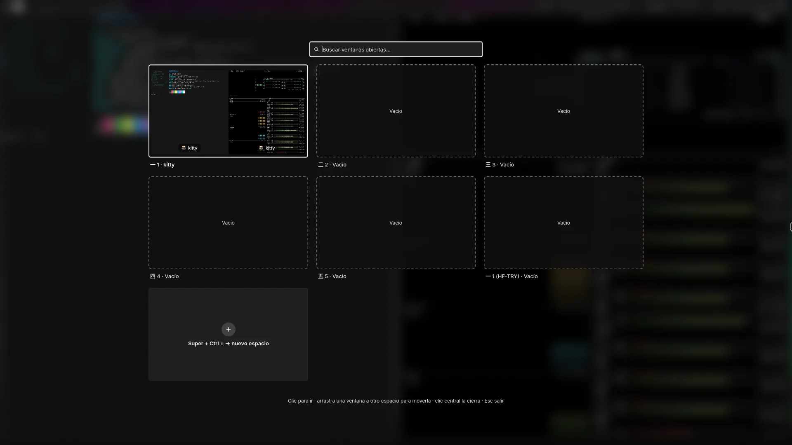 |
| **Asistente de IA** · panel lateral que cambia el escritorio con tu aprobación | **Vista general** · espacios de trabajo con sus ventanas y buscador |
| 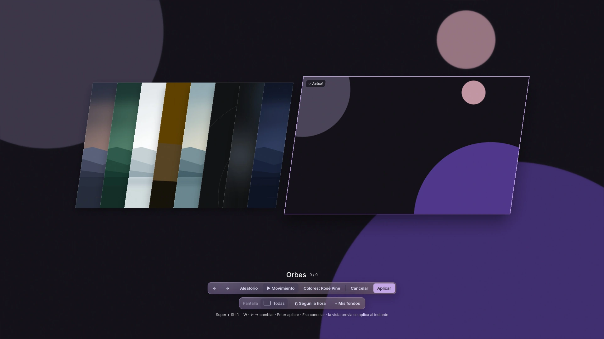 | 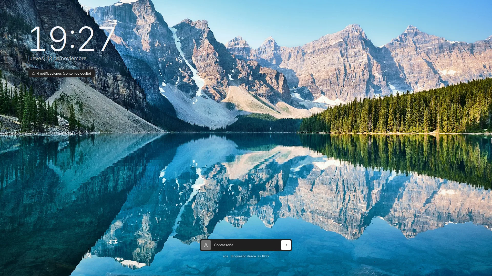 |
| **Selector de fondos** · vista previa al instante (también vídeo), por pantalla o según la hora | **Bloqueo** · reloj, tu foto y tu fondo, con contraseña o huella |
| 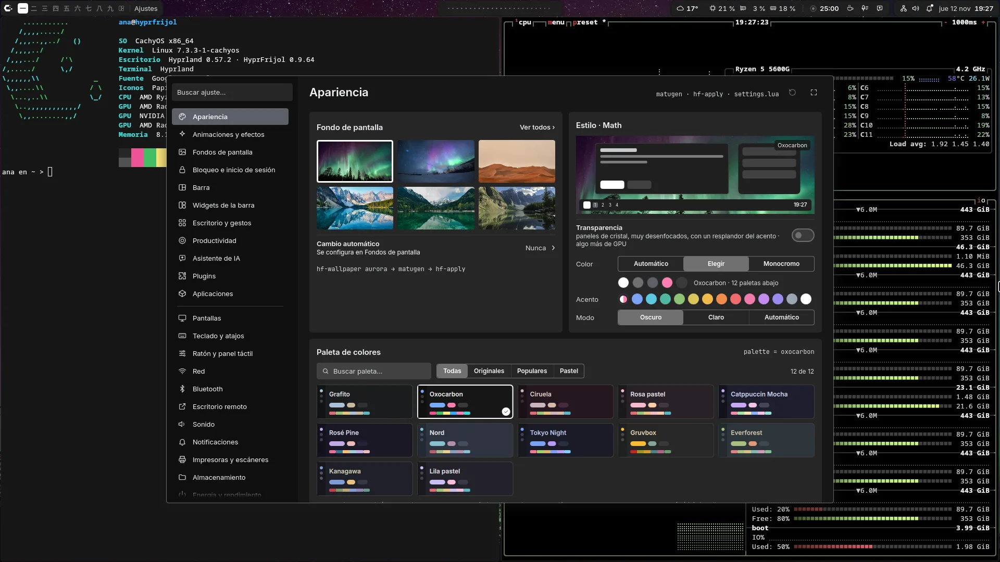 | 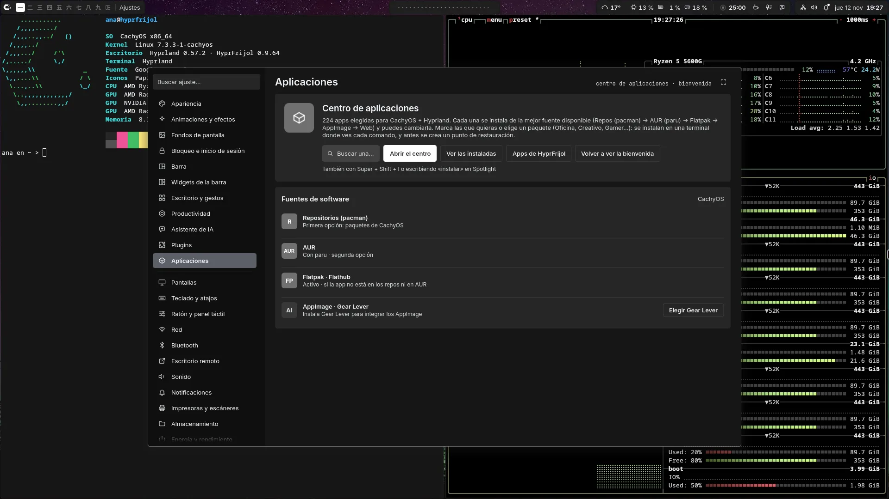 |
| **Ajustes › Apariencia** · estilo Math, temas en pares oscuro y claro (aquí Oxocarbon) y acento | **Ajustes › Aplicaciones** · centro de aplicaciones por categorías y origen |
| 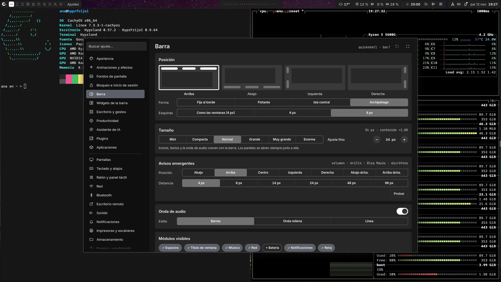 | 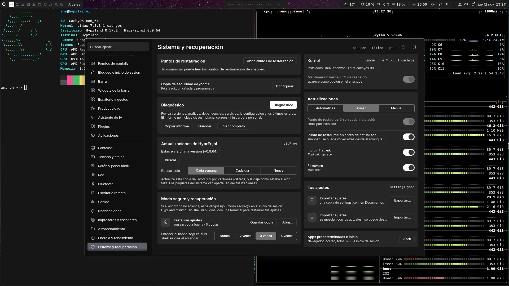 |
| **Ajustes › Barra** · posición, forma, tamaño y módulos visibles | **Ajustes › Sistema** · puntos de restauración, diagnóstico, actualizaciones y modo seguro |
| 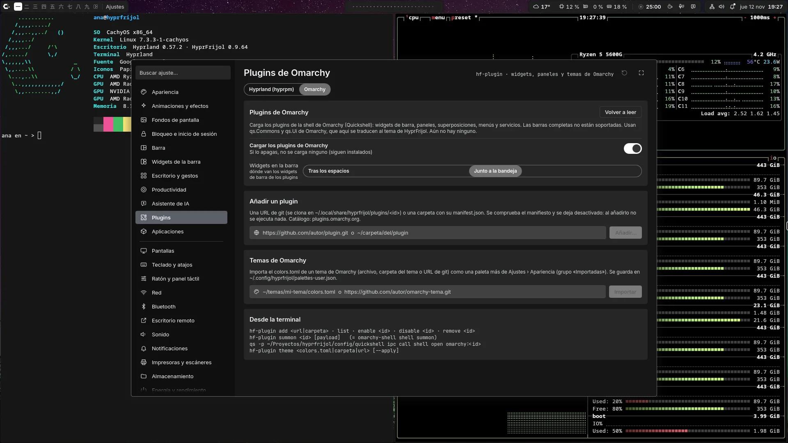 | |
| **Ajustes › Plugins de Omarchy** · widgets, paneles y temas de Omarchy | |

## Instalación

**Requisitos:** Hyprland **0.57 o posterior** (la configuración está en Lua) con `start-hyprland`, Quickshell **0.3 o posterior** y una GPU con driver KMS (Intel/AMD con Mesa; NVIDIA con su driver y `nvidia_drm.modeset=1`). No hace falta escritorio, servidor X ni gestor de inicio: sirve una instalación mínima o de servidor.

### En una línea

```bash
curl -fsSL https://raw.githubusercontent.com/fsanchezlme97-ui/hyprfrijol/main/install/bootstrap.sh | bash
```

Descarga el repo en `~/.local/src/hyprfrijol` (otra carpeta: `HF_DIR=…`) y ejecuta `./install.sh`. Las opciones se pasan detrás: `… | bash -s -- --dry-run`, `… | bash -s -- --yes --full`.

### A mano

```bash
git clone https://github.com/fsanchezlme97-ui/hyprfrijol ~/hyprfrijol    # la carpeta da igual
cd ~/hyprfrijol
./install.sh --dry-run    # enseña los comandos exactos sin tocar nada
./install.sh              # paquetes + servicios + scripts en ~/.local/bin + sesión «Hyprland (HyprFrijol)»
```

| Opción | Qué hace |
|---|---|
| `--dry-run` | solo enseña lo que haría (con `HF_DISTRO=fedora`, `debian`, `void`… simula otra distro) |
| `--yes` | sin preguntas (acepta lo recomendado) |
| `--full` | también los opcionales: máquinas virtuales, contenedores, VPN, escáner, Bluetooth, Valent (móvil), fondos animados, calculadora, firmware, VNC… |
| `--no-deps` | sin instalar paquetes (tú te encargas) |
| `--no-system` | sin tocar servicios ni grupos |
| `--no-session` | sin la entrada en el gestor de inicio |
| `--greeter` / `--greeter-off` | login visual propio con greetd / volver al gestor anterior (se guarda cuál era) |
| `--greeter-sync` | copia tu tema y tu fondo al login visual (`hf-greeter-sync`) |
| `--uninstall` [`--purge`] | desinstalar [y borrar ajustes, estado y caché] |
| `--migrate` | pasar una instalación de hypr-liquid (nombre anterior) a hyprfrijol |
| `--apps=serie,productividad,…` | apps por nivel: `serie` (por defecto), `productividad`, `destacada`, `creativa`, `experimental`, `all`; `--no-apps` ninguna. Sin `--yes` pregunta. Lista: `scripts/hf-apps list` |

Se puede repetir sin miedo: solo hace lo que falta. Al final enseña un resumen de lo instalado, lo saltado y lo que te toca a ti. Las dependencias están en [`install/packages.tsv`](install/packages.tsv) (imprescindibles, recomendadas y opcionales, con el nombre del paquete en cada familia).

Cada dependencia dice qué función la usa (Ajustes › Impresoras, Dictado, Máquinas virtuales…). Para ver qué falta y añadir una función después, sin reinstalar:

```bash
hf-deps status                 # cada función: lo instalado y lo que falta
hf-deps install impresoras     # o un id (alsa, vm…), --recommended o --all; --dry-run para ver los comandos
hf-deps explain lpstat         # qué función usa ese programa y qué paquete lo trae
```

`hf-doctor` lista las recomendadas que faltan, por función, con su `hf-deps install …`.

### Por distro

| Distro | Hyprland ≥ 0.57 | Quickshell | Qué hace el instalador |
|---|---|---|---|
| **Arch**, CachyOS, EndeavourOS, Garuda | repos oficiales | repos oficiales | todo automático; `mpvpaper` (opcional) desde AUR con paru/yay |
| **Manjaro** | rama *testing* (la estable va por detrás) | repos oficiales | igual que Arch; si tu Hyprland es antiguo te dice cómo cambiar de rama |
| **Fedora 44+** | COPR `lionheartp/Hyprland` | el mismo COPR | activa el COPR (pregunta) e instala todo |
| RHEL, Rocky, Alma 10 | — (compilar) | EPEL + COPR `errornointernet/quickshell` | instala el resto y te dice cómo compilar Hyprland |
| **openSUSE Tumbleweed** / Slowroll | repos oficiales | OBS `home:AvengeMedia:danklinux` | añade el repo OBS (pregunta) e instala todo |
| openSUSE Leap | — | OBS | instala el resto; Hyprland no existe para Leap |
| **Debian 14 (testing/forky)**, sid | repos oficiales | repos oficiales | todo automático; `matugen` se compila con cargo |
| Debian 13 (trixie) | — (backports trae 0.55) | trixie-backports | instala el resto; te dice cómo pasar a testing |
| **Ubuntu 26.04**, derivadas | PPA `cppiber/hyprland` | PPA `avengemedia/danklinux` | añade los PPAs (pregunta) e instala todo |
| **Ubuntu 24.04**, Mint 22, Pop!_OS 24.04 | PPA `cppiber/hyprland` | — (compilar) | instala el resto; `matugen` con cargo; te enlaza la guía de Quickshell |
| Ubuntu 26.10 | — (trae 0.56) | PPA `avengemedia/danklinux` | instala el resto y te dice tus opciones |
| **Void** | — (compilar o Nix) | repos oficiales | instala el resto, activa dbus/elogind/polkitd/NetworkManager (runit) y prepara PipeWire |
| Gentoo | `hyproverlay` | `guru` | te da los `emerge` y hace la parte de usuario |
| NixOS | `programs.hyprland` | nixpkgs | te da el bloque de `configuration.nix` y hace la parte de usuario |
| Otra | | | te da la lista de dependencias y sigue con `--no-deps` |

Los PPAs, COPR y repos OBS son **comunitarios** (no oficiales); el instalador pregunta antes de añadirlos. Comprobado en noviembre de 2026.

### Sistema mínimo (sin escritorio)

Además de los paquetes, el instalador deja lista una sesión que arranca sin escritorio:

- logind (systemd) o, en Void, los servicios `dbus`, `elogind` y `polkitd`; tu usuario en el grupo `video` (brillo);
- PipeWire + WirePlumber como servicios de usuario (en Void los arranca la sesión);
- NetworkManager activado **solo si no hay otro gestor de red en marcha** (systemd-networkd, ifupdown, wicked…); si lo hay, avisa y te dice cómo pasarte, sin desactivar nada;
- tipografías (Inter, Noto, Noto Color Emoji, JetBrains Mono; la barra usa iconos SVG propios, no hace falta una Nerd Font), iconos Papirus, portales de Hyprland y GTK, polkit, llavero y las carpetas del usuario;
- aviso si la GPU es NVIDIA sin su driver, o si no hay `/dev/dri` (servidor o máquina virtual sin aceleración).

### Arrancar

- **Con gestor de inicio** (SDDM, GDM, greetd…): cierra sesión y elige «Hyprland (HyprFrijol)».
- **Sin gestor de inicio** (servidor, instalación mínima): entra en una TTY con tu usuario y ejecuta `hf-session`. Para que arranque solo en tty1, añade a `~/.bash_profile`:
  ```bash
  [ -z "$WAYLAND_DISPLAY" ] && [ "$(tty)" = /dev/tty1 ] && exec "$HOME/.local/bin/hf-session"
  ```
  O instala el login visual: `./install.sh --greeter`.
- **Probarlo sin cerrar sesión:** `hf-session --nested` lo abre en una ventana dentro de tu sesión actual (ciérralo con Super+Shift+Esc).

- **Dejarlo como tu otro equipo:** `hf-perfil guardar` guarda en `~/.config/hyprfrijol/perfil.json` (solo tuyo) lo que
  tienes: paquetes y apps, servicios, acceso remoto (SSH, cortafuegos, Tailscale, RustDesk), voz de Helpert, modelos de
  dictado y de Ollama, el login y tus ajustes. `hf-update` lo guarda solo antes de cada actualización. En el equipo
  nuevo: `./install.sh --perfil=perfil.json` (o `hf-perfil aplicar perfil.json`; `hf-perfil ver` dice qué falta). No
  lleva claves ni contraseñas ni tus fondos: guárdalo tú (USB, tu nube), nunca en el repo.

Si mueves la carpeta del repo, ejecuta desde la nueva ubicación `./install.sh --no-deps --no-system --no-session` para rehacer los enlaces de `~/.local/bin`.

### Desinstalar

```bash
./install.sh --greeter-off          # solo si activaste el login visual: vuelve a tu gestor anterior
./install.sh --uninstall            # quita ~/.local/bin/hf-*, los lanzadores y la entrada de sesión
./install.sh --uninstall --purge    # además quita el tema de las apps y borra ~/.config, ~/.local/state y ~/.cache de hyprfrijol
```

Los paquetes del sistema no se desinstalan (pueden ser de otros programas). Después puedes borrar la carpeta del repo.

### ¿Venías de hypr-liquid?

`./install.sh --migrate` (o `scripts/hf-migrate --dry-run` para verlo antes) mueve `~/.config`, `~/.local/state`, `~/.local/share` y `~/.cache/hypr-liquid` a `…/hyprfrijol` (con enlaces desde los nombres antiguos), renombra la carpeta del repo si se llamaba `hypr-liquid` (dejando un enlace), deja `~/.local/bin/hl-*` como enlaces a los `hf-*` y te imprime los pasos con `sudo` que falten (entrada de sesión, greetd, logind). Las variables `HL_*` siguen valiendo.

Los fondos se buscan en `~/Imágenes/Fondos`, si no en `~/Imágenes/Wallpapers` (o en `$HF_WALL_DIR`); si no hay, se usan los de `assets/wallpapers`.

## Estructura

```
config/
  hypr/            hyprland.lua + frijol/ (entorno, entrada, aspecto, reglas, atajos, inicio)
                   hyprlock.conf, hypridle.conf (estos siguen en formato hyprlang)
  quickshell/      shell.qml, Theme, Settings, Shell (estado y IPC), bar/, components/, services/, modules/<vista>/
  themes/          paletas del diseño
  matugen/         plantilla de colores desde el fondo
  apply/           extensiones de hf-apply (ajustes → Hyprland)
  cava/            onda de audio de la barra
  defaults/        ajustes, colores y plantilla de local.lua por defecto
install/           packages.tsv (dependencias por distro) y bootstrap.sh (instalación en una línea)
scripts/           hf-session, hf-apply, hf-wallpaper, hf-lock, hf-capture, hf-updates, hf-ai, hf-mcp,
                   hf-devices, hf-download, hf-wallhaven
assets/wallpapers/ fondos incluidos
greeter/           login con greetd
dev/               try.sh (sesión anidada + captura) y DESARROLLO.md
docs/              ARQUITECTURA.md, IA.md, AJUSTES.md y capturas/ (las del README)
design/            prototipo y capturas de cada pantalla
```

## Atajos principales

Son los mismos que en illogical-impulse (misma tecla, misma función), más los propios del rice. **Super + /** muestra la lista completa.

| Atajo | Acción |
|---|---|
| Super (pulsar y soltar) · Super + Espacio | Spotlight |
| Super + Tab | Vista general |
| Super + A (o B / O) | Panel lateral del asistente de IA |
| Super + N | Ajustes rápidos (con notificaciones) |
| Ctrl + Super + N · Super + Alt + N | Centro de notificaciones · no molestar |
| Super + V · Super + . | Spotlight en modo portapapeles · emojis |
| Super + / | Atajos de teclado |
| Super + M | Controles de música |
| Super + G | Widgets |
| Super + J | Mostrar / ocultar la barra |
| Super + I · Super + Shift + I | Ajustes · centro de herramientas |
| Super + Enter (o T) · E · W · C · X | Terminal · archivos · navegador · editor de código · editor de texto |
| Ctrl + Super + V · Ctrl + Shift + Esc | Mezclador de volumen · administrador de tareas |
| Super + Q · Super + Shift + Alt + Q | Cerrar · forzar cierre |
| Super + D · Super + F · Super + Alt + F | Maximizar · pantalla completa · pantalla completa simulada |
| Super + Alt + Espacio · Super + P | Flotante · fijar encima |
| Super + ← → ↑ ↓ | Acoplar a la mitad / maximizar / restaurar (Snap) |
| Super + Alt + flechas · Super + Shift + flechas | Mover el foco · mover la ventana |
| Super + Alt + W | Organizar ventanas |
| Alt + Tab · Alt + Shift + Tab · Alt + º | Cambiar de ventana · atrás · misma app |
| Super + 1…0 · Super + Shift + 1…0 · Super + Alt + 1…0 | Ir a espacio · mover ventana · enviar sin seguirla (con varias pantallas, los de la pantalla activa) |
| Super + Ctrl + ← → | Espacio anterior / siguiente |
| Super + Ctrl + Shift + flechas | Mover la ventana a otra pantalla (en desplazamiento, ← → mueven la columna) |
| Super + Shift + Espacio · Super + Ctrl + Espacio | Modo de ventanas de todos los espacios · solo de este |
| Super + º | Consola desplegable |
| Super + S · Super + Alt + S | Espacio oculto (scratchpad) · enviar ventana ahí |
| Impr Pant · Shift/Ctrl + Impr Pant | Captura · pantalla completa |
| Super + Shift + S · X · T · A | Captura (como Impr Pant: región, ventana, pantalla, grabar o GIF) · copiar texto (OCR) · traducir · preguntar a la IA |
| Super + Shift + C | Selector de color |
| Super + Shift + R (o Super + Alt + R) | Grabar; otra vez para parar |
| Super + Shift + W · Ctrl + Super + T · Super + Ctrl + W | Fondos · fondos · siguiente fondo |
| Ctrl + Super + Shift + D | Claro / oscuro |
| Super + - / Super + = (o ¡) | Lupa |
| Super + Shift + B · N · P · M | Pista anterior · siguiente · reproducir/pausar · silenciar |
| Super + Alt + M · Super + Shift + Alt + M | Micrófono: lo de su modo (dictar, hablar con el asistente o silenciar; como el botón de la barra) · cambiar de modo |
| Super + Z | Modo sin distracciones |
| Super + L · Super + Shift + L | Bloquear · suspender |
| Super + Esc · Ctrl + Alt + Supr | Menú de energía |
| Ctrl + Super + R | Reiniciar el shell |
| Super + Alt + F1 | Desactivar los atajos (máquinas virtuales) |
| Super + Shift + Esc | Salir de Hyprland |

En la barra: clic en la onda = controles de música (también Super + M), clic central = reproducir/pausar · campana: clic derecho = no molestar, clic central = borrar todas.

## Personalizar

`~/.config/hyprfrijol/local.lua` se carga al final y puede cambiarlo todo:

```lua
HF.terminal = "foot"
HF.files    = "nautilus"
hl.monitor({ output = "DP-1", mode = "2560x1440@144", position = "0x0", scale = 1 })
hl.config({ input = { kb_layout = "latam" } })
```

Casi todo se cambia desde la aplicación de Ajustes (Super + I; ver `docs/AJUSTES.md`); se guarda en `~/.config/hyprfrijol/settings.json` y `hf-apply` lo aplica. Desde la terminal:

```bash
hf-apply set palette=nord barPos=arriba themeMode=auto
qs -p ~/src/hyprfrijol/config/quickshell ipc call shell toggle spotlight
```

## Licencia

[MIT](LICENSE) © 2026 hyprfrijol contributors.

Los paquetes que instala el instalador (Hyprland, Quickshell, tipografías, iconos…) tienen sus propias licencias.
Los iconos de archivos, carpetas y lenguajes son de [Catppuccin Icons](https://github.com/catppuccin/vscode-icons)
(MIT, `config/quickshell/assets/catppuccin/LICENSE`).
